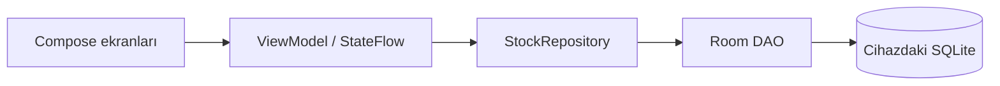
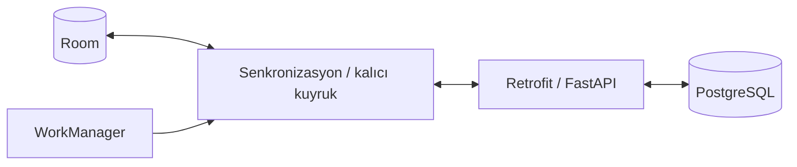

# İlk mimari ve veri modeli

## Mevcut uygulama

Veri okuma Room Flow → Repository → ViewModel StateFlow → Compose yönündedir. Yazma UI olayı → ViewModel coroutine → Repository transaction → Room yönündedir.

## Henüz geliştirilmemiş sonraki parçalar

## Yerel şema

| Tablo | Alanlar |
|---|---|
| categories | id: UUID, name, updatedAt, syncState |
| products | id: UUID, name, categoryId: nullable FK, updatedAt, syncState |
| stock_movements | id: UUID, productId: FK, type: IN/OUT, quantity: pozitif Long, note, createdAt, syncState, rejectionReason |

- Bir kategori birçok ürün içerir. Kategorisiz ürün mümkündür.
- Bir ürün birçok stok hareketi içerir.
- Hareket, ürün adı değişse de aynı ürün kimliğine bağlı kalır.
- Bu sürümde kayıtlar silinmez; FK ilişkileri kayıp geçmişi önler.
- Stok, REJECTED olmayan hareketlerde giriş toplamı eksi çıkış toplamıdır.
- PENDING cihazda kaydedilmiş ve henüz sunucudan onay alınmamış anlamındadır. Şu an tüm yeni kayıtlar PENDING kalır.
- SYNCED ve REJECTED durumları modelde tanımlıdır; sunucuyla bunlara geçiş henüz uygulanmadı.

## Transaction neden var?

Önce stoğu okuyup sonra bağımsız olarak çıkış eklemek güvenli değildir. İki coroutine aynı eski miktarı görüp iki ayrı çıkışı geçerli sanabilir. `withTransaction` aynı yerel veritabanındaki kontrol ve kaydı bir bütün olarak gerçekleştirir. Testte stok 10 iken eşzamanlı 12 adet 2 birimlik çıkış denenir; yalnızca 5'i kaydedilebilir.

## İşlem kimliği neden ürün kimliği değildir?

Bir ürüne ait farklı hareketlerin ayrı kimlikleri vardır. Aynı hareketin yeniden denenmesi ise aynı hareket kimliğini korur. Repository'de aynı kimlik ve içerik ikinci kez kaydedilmez; farklı içerik hata üretir. Bu yalnızca **yerel** korumadır. Aynı sözleşme sunucuda da transaction ve benzersiz kısıtlarla uygulanacaktır.

## Senkronizasyon aşamasındaki açık kararlar

- Kategori/ürün oluşturma ve düzenleme için kalıcı gönderim kuyruğu eklenecek. Şu an `syncState` bu kuyruğun yerine geçmez.
- Yeni kategoriden önce ürün, yeni üründen önce hareket gönderilmemeli.
- Stok değeri overwrite edilerek gönderilmez; bağımsız hareketler gönderilir.
- Hareketin sunucudaki kabulü, yanıt kaybı ve yerel onayı aynı kimlikle uzlaştırılmalı.
- Sunucu verisi alınırken onaylı hareket ile aynı yerel hareket iki ayrı kayıt sayılmamalı.
- İki cihazda ürün adı/kategori düzenleme çatışması için sürüm kontrolü ve kullanıcı incelemesi API sözleşmesi gününde kararlaştırılacak.
- Başka cihazdan gelen değişiklik bekleyen yerel çıkışları geçersiz yapabilir. Böyle kayıtlar sessizce kaybedilmeyecek veya stok değeri sıfıra kırpılmayacak; ayrı inceleme durumu senkronizasyon tasarımında ele alınacak.

Bu dosya başlangıç kararlarını açıklar; tamamlanmış dağıtık senkronizasyon tasarımı değildir.
